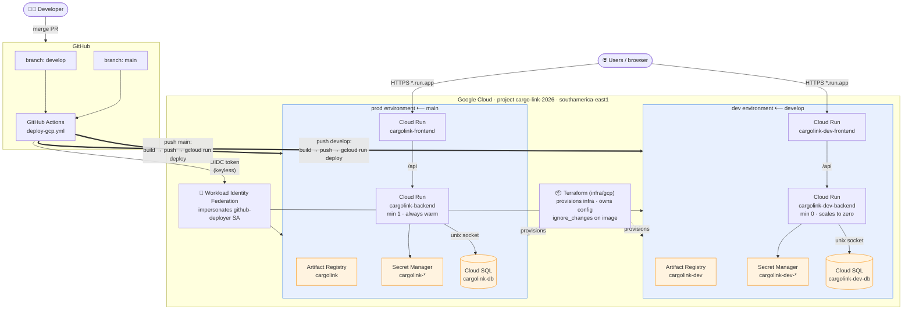

# Arquitectura de despliegue — GCP

Diagrama del despliegue de CargoLink en Google Cloud: dos entornos (dev/prod) con deploy continuo desde GitHub Actions, autenticación keyless vía Workload Identity Federation, e infraestructura como código con Terraform.

> Detalle operativo en [`ci-cd.md`](./ci-cd.md) (pipeline) y [`../infra/gcp/README.md`](../infra/gcp/README.md) (Terraform + setup).

## Cómo leerlo

- **Developer → GitHub**: cada merge a `develop` o `main` dispara el workflow `deploy-gcp.yml`.
- **Autenticación keyless**: GitHub Actions obtiene un token OIDC; Workload Identity Federation lo valida (restringido al repo) y deja impersonar la service account `github-deployer`. No hay keys guardadas en GitHub.
- **Dos entornos** en el mismo proyecto `cargo-link-2026`, totalmente separados (Cloud Run, Cloud SQL, Secret Manager y Artifact Registry propios):
  - `develop` → **dev** (`cargolink-dev-*`), backend escala a cero.
  - `main` → **prod** (`cargolink-*`), backend siempre caliente.
- **CI vs Terraform**: el workflow builda la imagen y la deploya con `gcloud run deploy`; Terraform (en `infra/gcp/`) provisiona y es dueño del resto de la config. El `ignore_changes` sobre la imagen evita que se pisen.
- **Frontend → backend**: el frontend llama a la API en `/api`; `NEXT_PUBLIC_API_URL` se hornea en el build de CI resolviendo en vivo la URL del backend del entorno.
- **TLS**: automático en las URLs `*.run.app` de Cloud Run.
